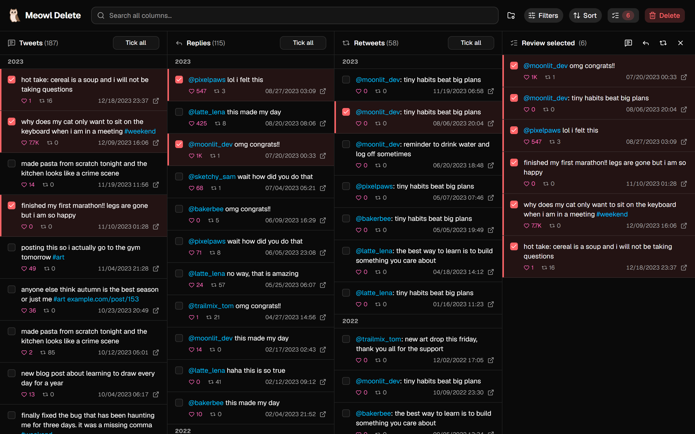
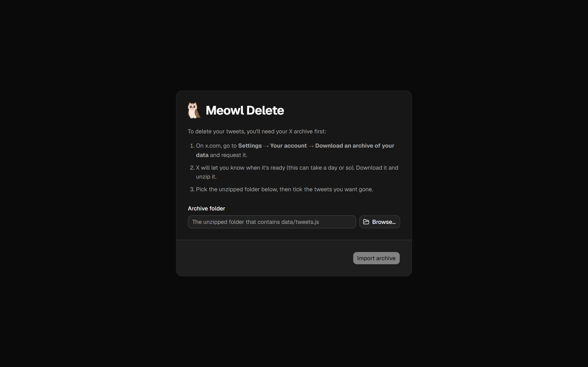
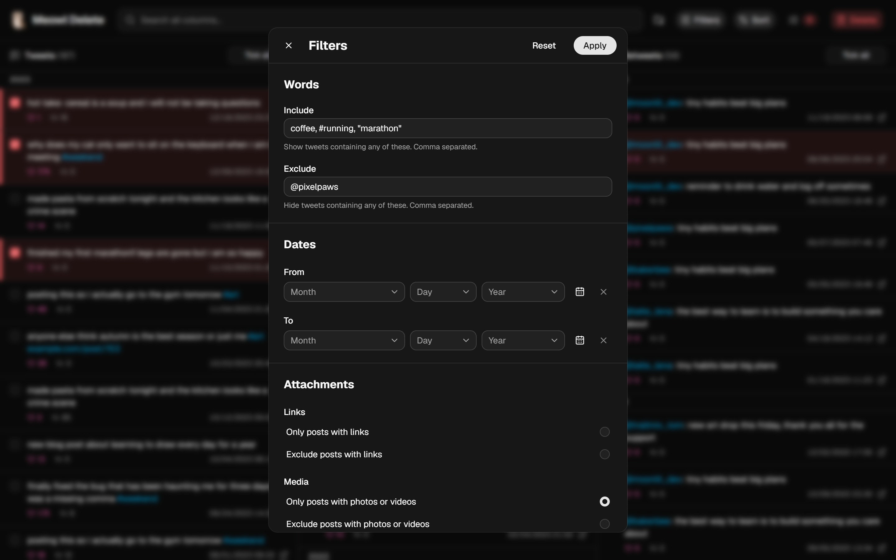
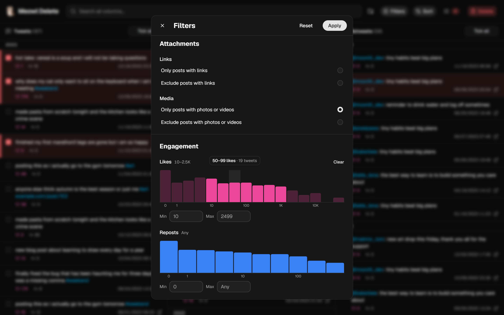

<div align="center">
   
  <h1> Meowl Delete </h1>
</div>

A desktop app for browsing your Twitter/X data archive in three side-by-side columns (tweets, replies, retweets), ticking what you want gone, and bulk-deleting it from X with live progress.

Built with [Electrobun](https://blackboard.sh/electrobun/) (main process on Bun, native system webview) and a React + [shadcn/ui](https://ui.shadcn.com) interface. Deletion goes through [emusks](https://emusks.tiago.zip), a reverse-engineered X client, using your own `auth_token` cookie.

>  Using unofficial X APIs breaks X's Terms of Service and could get the account limited. Deletion is permanent!

## Screenshots



<table>
  <tr>
    <td width="33%"></td>
    <td width="33%"></td>
    <td width="33%"></td>
  </tr>
  <tr>
    <td align="center">Setup</td>
    <td align="center">Filters</td>
    <td align="center">Engagement: drag to pick a range</td>
  </tr>
</table>

<sub>Screenshots use a made-up demo archive.</sub>

## Setup

Requires [Bun](https://bun.sh) 1.2+.

```bash
bun install
```

The first `bun run …` downloads Electrobun's toolchain (Hutch) into `~/.hutch` and prepares the SDK in `.hutch/devkit`.

## Use

```bash
bun run start     # build the UI and open the app
bun run dev       # same, rebuilding the app when src/bun changes
bun run dev:hmr   # Vite hot reload for the UI (src/mainview) inside the app
bun run build     # packaged app for this platform → build/ and artifacts/
```

In the app:

1. **Choose your archive.** Download it from x.com → Settings → Your account → Download an archive, unzip it, then pick the folder that contains `data/tweets.js`. Change it later with the folder button in the header.
2. **Tick tweets.** Click a tweet (or shift-click a range) to tick it. Ticks autosave. Narrow the columns with the search box and **Filters** (include/exclude words, phrases, #tags and @accounts, links/media, dates, and likes/reposts, where you can drag across a chart to pick a range); each column's **Tick all** / **Untick all** button only affects what's shown. The **Review selected** button (the list icon with the count) opens a side panel of everything ticked (drag its edge to resize) that stays open while you keep ticking.
3. **Delete.** Press **Delete**, paste your `auth_token` the first time (the dialog explains where to find it) and press **Delete**. Progress shows under the header, with **Stop**.

Ctrl + / Ctrl − / Ctrl 0 (or Ctrl + mouse wheel) scale the whole UI.

Runs are resumable: each success is recorded in `deleted.json` immediately. X allows roughly 200 deletes per 15 minutes per account; the deleter waits out rate limits automatically. A new token for the same account doesn't help.

The app keeps its files (parsed archive, ticks, deletion log) in its per-user data folder, shown under "How do I get my auth_token?" in the delete dialog. Once X accepts your auth token, the app remembers it in memory until you quit (so later deletes don't ask again); it's never written to disk.

### Command line

```bash
bun delete-selected.ts --data "<data folder>"                              # dry run of what's ticked
X_AUTH_TOKEN=… bun delete-selected.ts --data "<data folder>" --confirm     # delete what's ticked
X_AUTH_TOKEN=… bun test-delete.ts [--confirm] <tweet links…>               # test on any account
```

## Layout

| Path | Purpose |
|---|---|
| `src/bun/index.ts` | Electrobun main process: opens the window, starts the local server |
| `src/bun/server.ts` | Local API (`Bun.serve`): serves the UI and media, saves ticks, imports the archive, runs deletions |
| `src/bun/archive.ts` | Parses the archive into `tweets.json` |
| `src/bun/deleter.ts` | Deletion logic (emusks, retries, rate-limit backoff, resumable state) |
| `src/bun/cycletls.ts` | Points emusks' CycleTLS helper at the copy shipped inside the packaged app |
| `src/mainview/` | React + shadcn/ui interface (`components/ui` is generated by `bunx shadcn add …`) |
| `electrobun.config.ts` | App metadata and build config (`mainProcess: "bun"`) |
| `delete-selected.ts` / `test-delete.ts` | Command-line deletion |

## License

AGPL-3.0-only (required by emusks, which is AGPL-3.0; CycleTLS is GPL-3.0).
